<div align="center">


<br/>

**Игровой оверлей для Windows: мгновенный повтор, запись, скриншоты и фильтры.**

Rewind постоянно хранит последние минуты игры. Чтобы сохранить момент, достаточно нажать сочетание клавиш — включать запись заранее не требуется.

<br/>


<a href="LICENSE"></a>

</div>

---

> [!IMPORTANT]
> При установке Rewind перенаправляет на себя запуск оверлея NVIDIA. Microsoft Defender может расценить это как подозрительное поведение и поместить файл в карантин. Срабатывание вызвано самим способом перенаправления и не связано с записью или клипами. Чтобы Rewind работал, добавьте папку установки в исключения Defender.

## Что это такое

Rewind — оверлей для записи игр, который выполняет ту же задачу, что и NVIDIA ShadowPlay. Программа ведёт непрерывную запись в кольцевой буфер, поэтому последние минуты игры всегда доступны. Клип сохраняется на диск одним сочетанием клавиш уже после того, как событие произошло.

После установки Rewind занимает место оверлея NVIDIA: открывается тем же сочетанием клавиш и получает от игр те же события для автоматической записи лучших моментов.

## Что умеет

- **Мгновенный повтор.** Непрерывный буфер последних минут игры. Клип сохраняется одним сочетанием клавиш. Если захват прервался из-за сбоя видеодрайвера, запись возобновляется автоматически.
- **Запись.** Обычная запись экрана или только окна игры с выбором качества, разрешения, частоты кадров и кодека. Системный звук, микрофон и Discord можно записывать на отдельные дорожки.
- **Скриншоты.** По нажатию клавиши экран замирает, и можно выбрать область, окно или весь экран. Снимок можно скопировать в буфер обмена, сохранить, закрепить поверх окон или открыть в редакторе: карандаш, стрелки, текст, размытие, обрезка.
- **Публикация скриншотов.** Снимок загружается на выбранный хостинг — Catbox, ImgBB или Pixhost — а ссылка сразу попадает в буфер обмена. Аккаунт для этого не нужен.
- **Лучшие моменты.** Rewind получает от игры события (убийства, серии, победы в раунде) и автоматически сохраняет клипы. В галерее можно оставить удачные и удалить остальные.
- **Игровые фильтры и фоторежим.** Цветовые фильтры поверх игры и свободная камера. Для каждой игры сохраняется до трёх профилей фильтров.
- **Редактор клипов.** Обрезка, отключение звуковых дорожек, сохранение кадра — без сторонних программ.
- **Загрузка на YouTube.** Клип отправляется на канал прямо из уведомления о сохранении.
- **Темы оформления.** Четыре темы — Классика, Карбон, Рубин и Светлая. Они меняют цвета, форму элементов управления и значки.
- **Низкое потребление памяти.** Один нативный процесс занимает в фоне около 43 МБ. Результаты измерений приведены [ниже](#потребление-памяти).

## Сравнение с NVIDIA ShadowPlay

Rewind решает ту же основную задачу — постоянно включённый буфер повтора — и устраняет распространённые недостатки стандартного оверлея.

| | NVIDIA ShadowPlay | **Rewind** |
|---|:---:|:---:|
| Буфер мгновенного повтора | ✅ | ✅ |
| Переживает DRM / «защищённый контент» | ❌ молча **выключает** повтор, когда на экране Chrome, Netflix, страница магазина или лаунчер | ✅ продолжает записывать — нет выключателя по защищённому контенту |
| Восстанавливается после сбоя GPU | ⚠️ часто просто останавливается, пока не включишь заново | ✅ цикл захвата перезапускается сам при потере устройства |
| Аккаунт / вход | ❌ NVIDIA App теперь требует вход | ✅ никакого — просто работает |
| Телеметрия | ❌ включена по умолчанию | ✅ нет |
| Авто-клипы лучших моментов | ✅ (NVIDIA Highlights, мало игр, часто сломаны) | ✅ тот же игровой протокол, галерея «пересмотри и оставь» |
| Цветовые фильтры и фоторежим | ✅ | ✅ + до 3 сохранённых профилей на игру |
| Темы / внешний вид | ❌ один фиксированный UI | ✅ четыре темы ручной работы |
| Встроенный редактор клипов и снимков | ⚠️ минимальный | ✅ обрезка, глушение дорожек, захват кадра |
| Загрузка на YouTube в один клик | ⚠️ много возни со входом | ✅ прямо из уведомления о сохранении |
| Открытый исходный код | ❌ | ✅ для некоммерческого использования |
| След установки | NVIDIA App + веб-сервисы | один нативный исполняемый файл |
| Потребление памяти | ~1,25 ГБ резидентно, 16 процессов¹ | **~43 МБ, один процесс**¹ |

### Потребление памяти

Измерения выполнены на тестовой системе: **Intel Core i5-12400F, NVIDIA RTX 3060, 32 ГБ ОЗУ, Windows 11 Pro**. Показатель — *Working Set*, то есть объём занятой физической памяти. Результаты зависят от конфигурации компьютера, версии драйвера и настроек.

| Состояние | NVIDIA App | **Rewind** | Разница |
|---|:---:|:---:|:---:|
| Оверлей активен, в фоне во время игры | **~1,25 ГБ**, 16 процессов | **~43 МБ**, 1 процесс | **~29× меньше** |
| Только оверлей и фоновые службы, окно приложения закрыто | ~774 МБ | ~43 МБ | ~18× меньше |
| Открыт интерфейс | ~1,26 ГБ | ~137 МБ | ~9× меньше |

¹ Пока оверлей NVIDIA включён, его процессы остаются в памяти: закрытие окна не выгружает их, а фоновая служба запускает их заново. Освободить память можно только полным выходом из NVIDIA App, при этом мгновенный повтор отключается.

> Rewind — независимый проект. Он не связан с компанией NVIDIA и не одобрен ею. «ShadowPlay» и «NVIDIA» — товарные знаки NVIDIA Corporation, они упоминаются только для описания совместимости.

## Установка и использование

1. Скачайте установщик `Rewind-Setup.exe` со страницы [релизов](https://github.com/xpepelok/rewind/releases).
2. Запустите его и нажмите «Установить». Установщик заменит оверлей NVIDIA на Rewind и добавит программу в автозагрузку.
3. Откройте оверлей сочетанием клавиш (по умолчанию Alt+Z) и при необходимости измените сочетания в разделе «Параметры».

Удалить Rewind можно через «Установленные приложения» Windows или в разделе «Параметры → Замена NVIDIA ShadowPlay». При удалении все изменения отменяются, и оверлей NVIDIA возвращается в исходное состояние.

## Скриншоты

<div align="center">

| Главная оверлея | Игровые фильтры | Фоторежим |
|:---:|:---:|:---:|
| 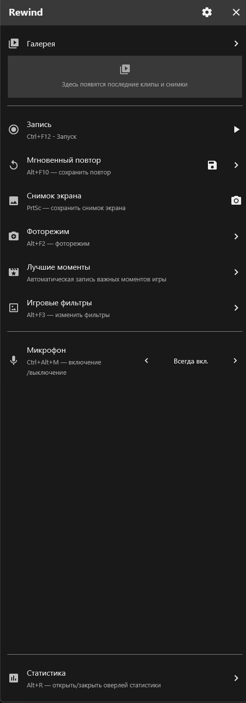 | 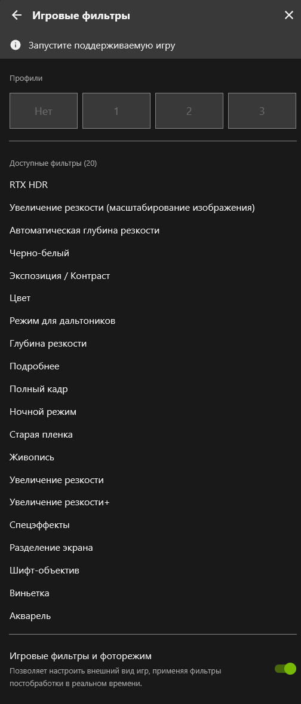 | 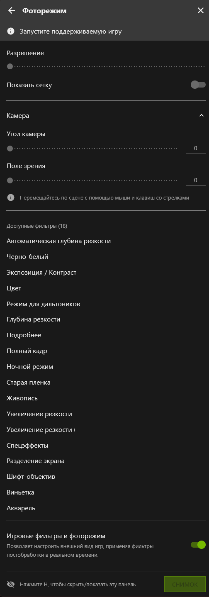 |

| Мгновенный повтор | Параметры | Темы |
|:---:|:---:|:---:|
| 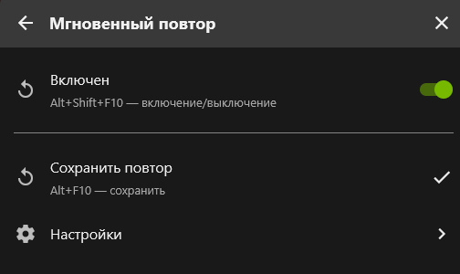 | 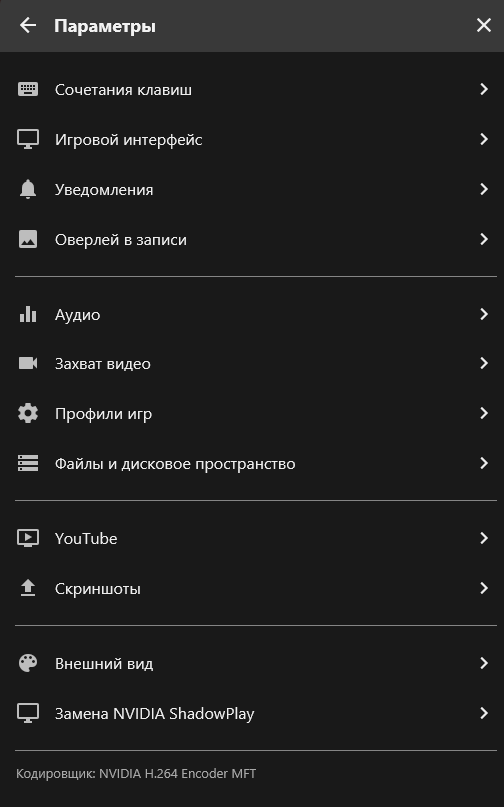 | 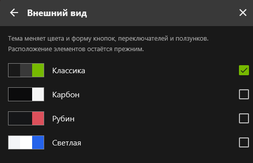 |

</div>

<details>
<summary><b>Ещё экраны настроек</b></summary>

<br/>

<div align="center">

| Захват видео | Сочетания клавиш | Игровой интерфейс |
|:---:|:---:|:---:|
| 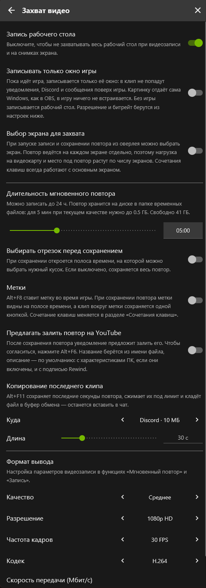 | 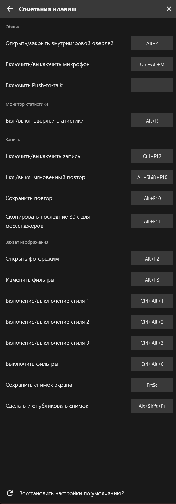 | 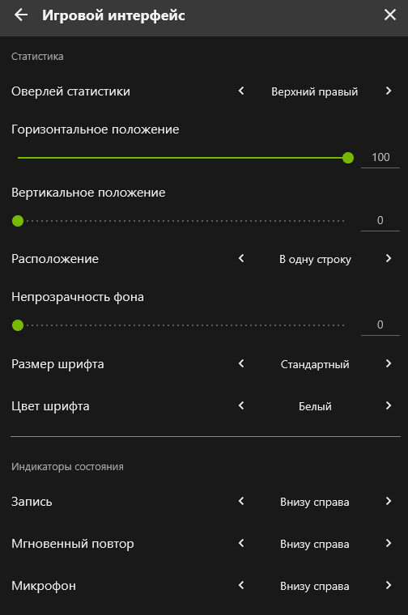 |

| Аудио | Скриншоты | Уведомления |
|:---:|:---:|:---:|
| 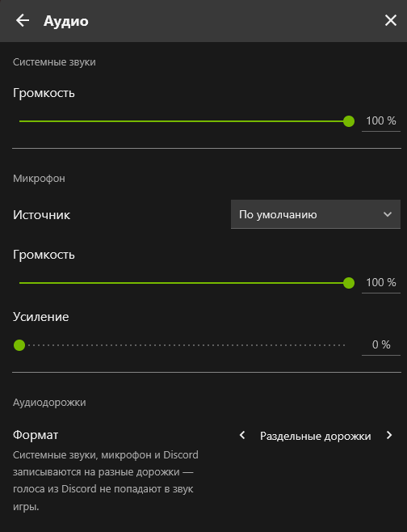 | 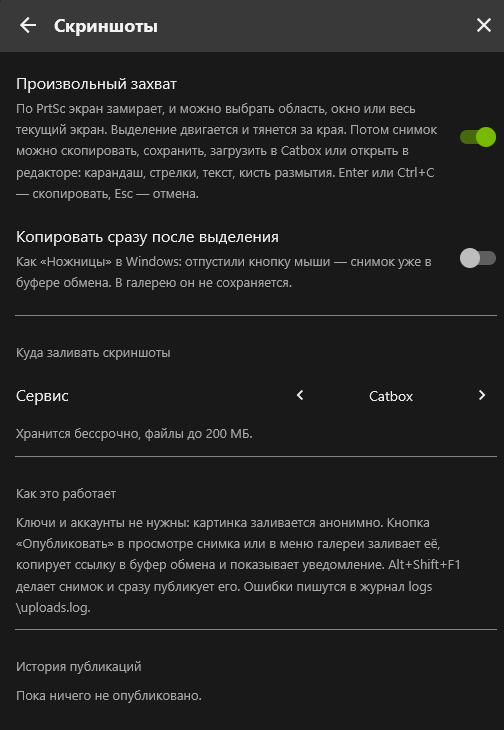 | 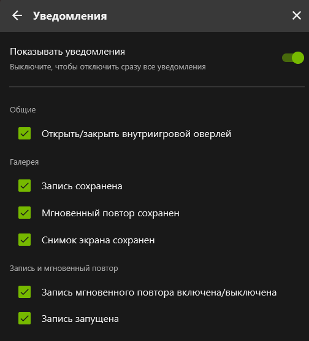 |

| YouTube | Оверлей в записи | Замена NVIDIA ShadowPlay |
|:---:|:---:|:---:|
| 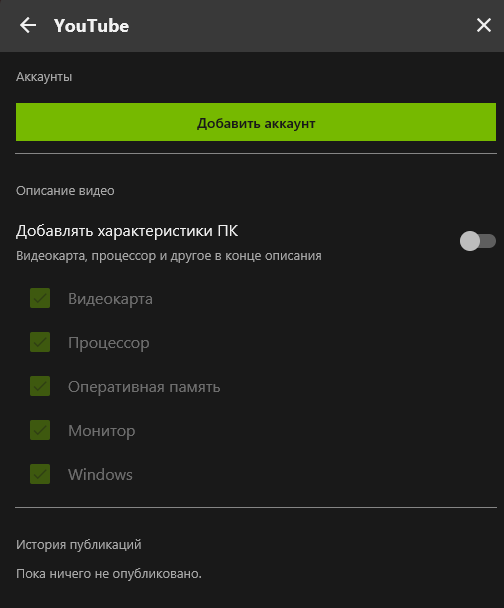 | 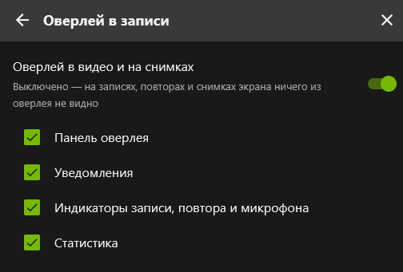 | 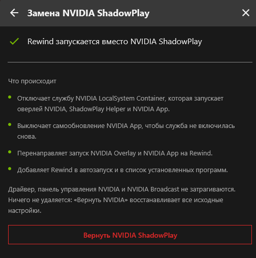 |

</div>

</details>

## Как это работает

При установке Rewind занимает место оверлея NVIDIA:

- **Перенаправляет** запуск `NVIDIA Overlay.exe` и `NVIDIA App.exe` на себя (через Image File Execution Options).
- **Отключает** службу `NvContainerLocalSystem` и задачи самообновления NVIDIA на время установки.
- **Добавляет** задачу запуска при входе в систему и запись в «Установленных приложениях».

Драйвер, панель управления NVIDIA и NVIDIA Broadcast не затрагиваются. Все изменения записываются и полностью отменяются при удалении.

## Частые вопросы

### Defender удалил файл или сообщает об угрозе

Срабатывание вызвано перенаправлением запуска оверлея NVIDIA и не связано с записью. Добавьте папку установки в исключения Defender и запустите установщик ещё раз.

### Оверлей не открывается в игре

Убедитесь, что сочетание клавиш назначено и не занято другой программой. Если игра работает в эксклюзивном полноэкранном режиме, переключите её в режим «окно без рамки».

### Повтор не сохраняется или клип пустой

Проверьте, что мгновенный повтор включён, а на диске с временными файлами достаточно места. После сбоя видеодрайвера запись возобновляется автоматически в течение нескольких секунд.

### С включённым оверлеем снизилась производительность

Уменьшите качество, разрешение или частоту кадров записи в разделе «Захват видео». Основную нагрузку создаёт кодирование видео.

### Как вернуть оверлей NVIDIA

Удалите Rewind или нажмите «Вернуть NVIDIA ShadowPlay» в параметрах. Перенаправления, служба и задачи NVIDIA будут восстановлены автоматически.

### Проблемы нет в списке

Создайте issue в репозитории и опишите, что произошло. К сообщению полезно приложить файлы из папки `logs`.

## Сборка

Потребуется актуальный набор инструментов **Rust**, а также **Windows SDK** — он нужен для встраивания значка в исполняемый файл.

```bash
cargo build --release -p rewind
```

Собранный установщик появится в папке `target/release`.

## Поддержка проекта

Если программа оказалась полезной, поставьте репозиторию звезду. Сообщения об ошибках и предложения принимаются в issues.

## Лицензия

Проект распространяется по лицензии [PolyForm Noncommercial 1.0.0](LICENSE): программу и её исходный код можно свободно использовать, изменять и распространять в некоммерческих целях. Коммерческое использование запрещено.

## Благодарности

Интерфейс построен на [gpui](https://www.gpui.rs/). Спасибо всем, кто сообщает об ошибках и предлагает улучшения.
